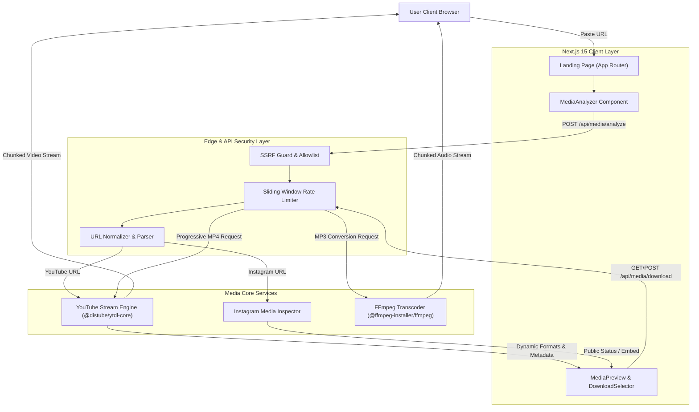

# MediaFlow Technical Architecture

## 1. System Overview

MediaFlow is a high-performance, stateless web application engineered to analyze public media from YouTube and Instagram, inspect available formats and resolutions dynamically, and stream downloadable video/audio directly to client browsers without requiring a persistent database or user authentication.

---

## 2. Layer Decomposition

### A. Frontend Layer (Next.js 15 App Router & Tailwind CSS)
- **Component Hierarchy**: Modular, decoupled components (`MediaAnalyzer`, `MediaPreview`, `DownloadSelector`, `ProcessingStatus`, `Navbar`, `Footer`).
- **Theming**: Dark/Light mode implemented via CSS variables and `next-themes` with zero hydration flash.
- **Dynamic Formatting**: Available resolutions (144p to 4K, MP3) are rendered dynamically from source manifests — no hardcoded or fake options.

### B. Security & Validation Layer
- **SSRF Defense (`lib/security/ssrf.ts`)**: Rejects private IP ranges (`127.0.0.0/8`, `10.0.0.0/8`, `192.168.0.0/16`, `169.254.169.254` AWS metadata), local hostnames, and arbitrary URL schemes. Only `youtube.com`, `youtu.be`, and `instagram.com` are permitted.
- **Stateless Rate Limiting (`lib/security/rate-limiter.ts`)**: In-memory sliding window bucket per client IP (40 analyze req/min, 20 download req/min) with auto-purging timers every 5 minutes.
- **Filename Sanitization**: Removes control characters and quotes from `Content-Disposition` headers and supplies RFC 5987 encoded `filename*` attributes.

### C. Media Extraction & Processing Layer
- **YouTube Engine (`lib/extractors/youtube.ts`)**: Inspects stream manifests to categorize formats into:
  - *Video + Audio Combined* (e.g., progressive 720p HD, 360p MP4)
  - *Adaptive Video Only* (e.g., 1080p, 1440p, 4K UHD)
  - *Audio Tracks* (e.g., M4A AAC, WebM Opus, and on-the-fly MP3)
- **Instagram Engine (`lib/extractors/instagram.ts`)**: Validates Reels and public posts. Respects Meta access controls by preventing scraping of private profiles and providing clear explanations when Stories or login-walled reels are encountered.
- **FFmpeg Transcoding Pipeline (`lib/processing/ffmpeg.ts`)**: Streams source audio directly through `fluent-ffmpeg` with `libmp3lame` at 192 kbps, converting Node.js streams to standard WHATWG `ReadableStream` for chunked HTTP delivery.

---

## 3. Database-Free Guarantee

Per requirements:
- **No Database**: 0 database engines (no PostgreSQL, MySQL, SQLite, MongoDB, Prisma, or Redis).
- **No User Accounts**: No registration, passwords, sessions, or tracking cookies.
- **Transient Memory Only**: All processing operates as a direct stream pipeline without permanent disk storage.

